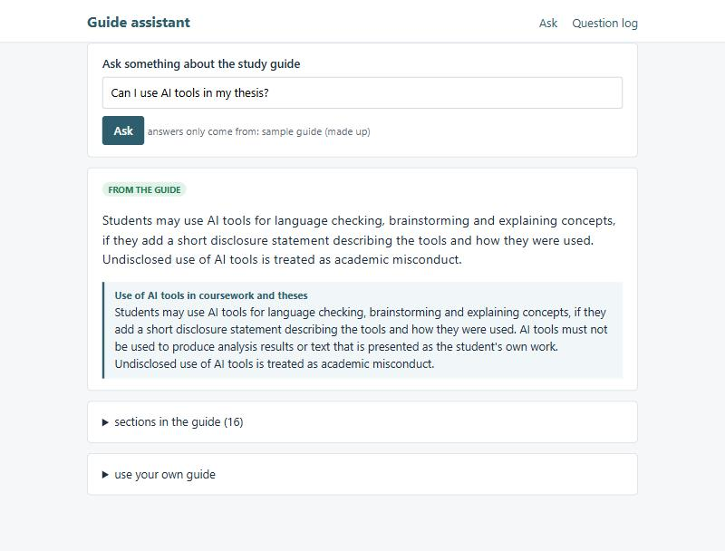
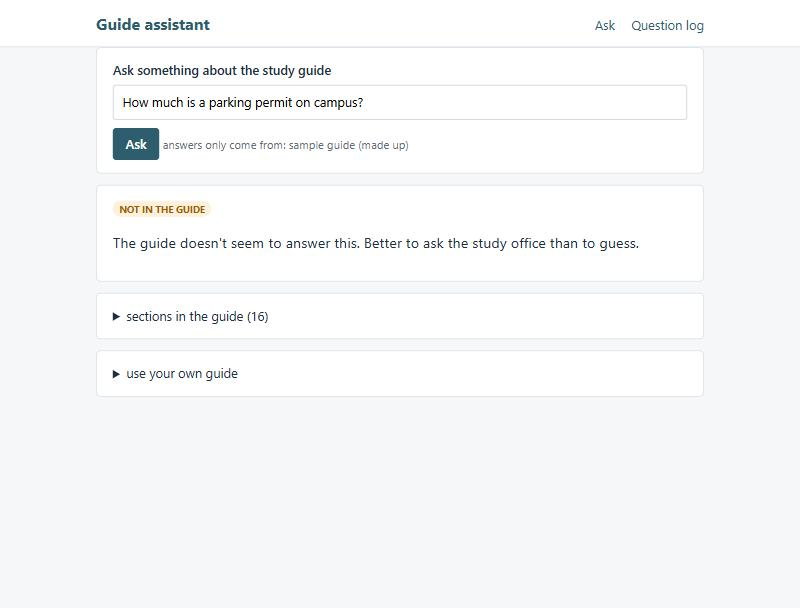
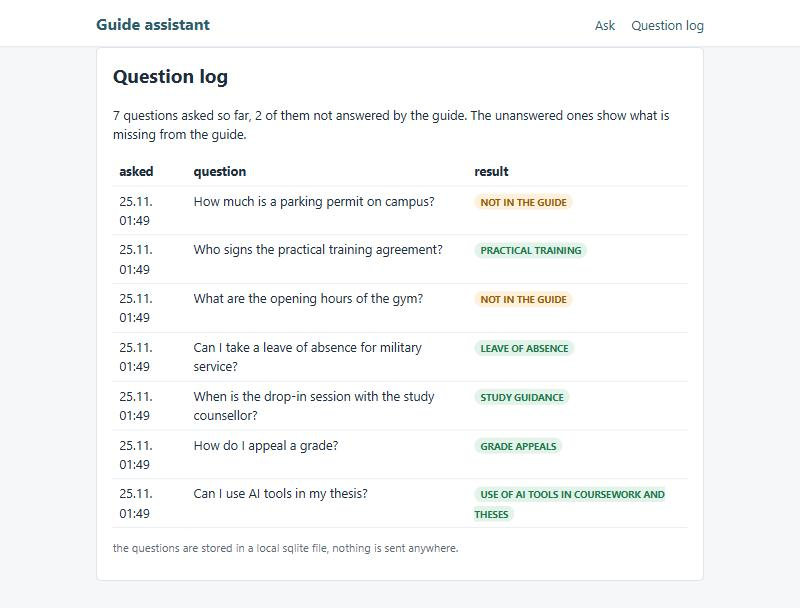

# Guide assistant

Small Flask app for the Metropolia student coder application. You ask a practical question about a study guide ("can I use AI tools in my thesis?") and it answers from the guide text only. It shows which section the answer came from, and if the guide doesn't cover the question it says so instead of guessing.

The idea came from the obvious problem with putting a chat model on top of university rules: it will happily make up a deadline that sounds official. Here the answer always comes with its source, and the questions it couldn't answer are saved, so someone can see what the guide is missing.

## Run it

```
python -m venv .venv
.venv\Scripts\activate
pip install -r requirements.txt
flask --app app run --debug
```

then open http://127.0.0.1:5000

The guide is `guide.md`. It is made up for this demo, it is not Metropolia's real rules. You can also paste your own guide on the page (markdown, one `## title` per section).

## What is in it

- `guide.py` splits the guide into sections and scores them against the question (tf-idf style, plain python, no model). If the best section doesn't contain enough of the question's words it counts as "not in the guide".
- `app.py` the flask app. Questions are saved to a sqlite file with Flask-SQLAlchemy, and `/log` shows them. `/api/ask?q=...` returns the same lookup as json.
- `eval.py` runs the questions in `eval_questions.json` and prints how often the right section comes first.
- `test_app.py` pytest tests, run with `pytest`.
- Optional: if `LLM_URL`, `LLM_KEY` and `LLM_MODEL` are set, the found sections are sent to a chat model (openai style api) that is told to answer only from them. If that call fails it falls back to the plain answer. I haven't tried this against a real endpoint yet, only the fallback is tested.

## Results

`python eval.py` on my 16 questions + 4 off-topic ones: right section first 15/16, in the top 3 16/16, off-topic questions refused 4/4. One real question gets refused by mistake: "Can I use ChatGPT to write my thesis?", because the guide says "AI tools" and never "ChatGPT". The word matching can't see that those mean the same thing. The questions are my own and I set the 0.5 threshold looking at them, so the numbers are better than they would be on new questions.

## Deploying

`flask run` is only for development. To run it properly, with waitress:

```
waitress-serve --listen=127.0.0.1:8000 wsgi:app
```

and set `SECRET_KEY` to something real first. The pasted guide is kept in memory, so use a single process (waitress threads are fine, several worker processes are not). The question log is in `instance/questions.db`.

## Screenshots





## Things I'd change

- word matching misses synonyms (see the ChatGPT example). Query expansion or embeddings would fix that, then re-run `eval.py` on new questions to see if it really helps.
- the 4-letter word cutting is rough and not made for finnish.
- one guide, no users, no login on `/log`. Fine for a demo, not for real use.
